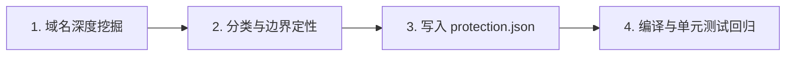

# Surge 规则设计架构、避坑指南与维护更新原理 (核心记忆库)

> 本文档为项目终极核心架构备忘与设计哲学指南，沉淀了历次实战抓包排查、113秒连接挂死惨剧、Apple海外服务机制、金融独立隔离与自动化更新防护的全部经验。
> **所有后续规则编写、版本迭代、排查卡顿与自动化维护必须严格遵照本文档执行。**

---

## 目录
1. [第一部分：血泪避坑指南 (The Pitfalls & Anti-Patterns)](#第一部分血泪避坑指南-the-pitfalls--anti-patterns)
   - [坑一：Apple“六大问题端点”绝不可直接强行 DIRECT（113秒假死惨剧复盘）](#坑一apple六大问题端点绝不可直接强行-direct113秒假死惨剧复盘)
   - [坑二：混淆“静态媒体 CDN”与“核心业务 API”](#坑二混淆静态媒体-cdn与核心业务-api)
   - [坑三：看抓包不能只看 Failed: True 表面现象](#坑三看抓包不能只看-failed-true-表面现象)
   - [坑四：金融与交易所服务绝不可共用出口或随意漂移 IP](#坑四金融与交易所服务绝不可共用出口或随意漂移-ip)
   - [坑五：AI 服务与住宅家宽的洁净度防线](#坑五ai-服务与住宅家宽的洁净度防线)
   - [坑六：远程更新脚本覆盖本地精心调优的规则](#坑六远程更新脚本覆盖本地精心调优的规则)
2. [第二部分：规则设计与创建原理 (Architecture & Design Principles)](#第二部分规则设计与创建原理-architecture--design-principles)
   - [1. 分层匹配与优先级金字塔](#1-分层匹配与优先级金字塔)
   - [2. 自适应 DNS + GEOIP 复合判断机制](#2-自适应-dns--geoip-复合判断机制)
   - [3. 策略组架构设计与优先级调优](#3-策略组架构设计与优先级调优)
   - [4. pre-matching 与 DNS 阶段拦截](#4-pre-matching-与-dns-阶段拦截)
3. [第三部分：规则更新与维护原理 (Update & Maintenance Principles)](#第三部分规则更新与维护原理-update--maintenance-principles)
   - [1. 新增 App 规则的标准收录 SOP](#1-新增-app-规则的标准收录-sop)
   - [2. 保护引擎（Protection Engine）与 CI/CD 自动构建守则](#2-保护引擎protection-engine与-cicd-自动构建守则)
   - [3. 网络性能卡顿排查 SOP（标准诊断四步法）](#3-网络性能卡顿排查-sop标准诊断四步法)

---

## 第一部分：血泪避坑指南 (The Pitfalls & Anti-Patterns)

### 坑一：Apple“六大问题端点”绝不可直接强行 DIRECT（113秒假死惨剧复盘）

* **涉及的六大端点**：
  1. `mobileapp.apple.com`（Apple Store 商城核心 API）
  2. `digitalassets-taa.cdn-apple.com`（商城动态业务资源）
  3. `gsa.apple.com`（Apple ID 身份鉴权与令牌校验）
  4. `gsas.apple.com`（Apple ID 安全认证衍生端点）
  5. `api.smoot.apple.cn`（Spotlight / 联想建议）
  6. `rtlimages.apple.com`（Apple Store 零售店、Genius Bar 与设备高清图）

* **惨剧复盘（113 秒连接重置）**：
  * **现象**：当直连上述域名（例如 `DOMAIN,mobileapp.apple.com,DIRECT`）时，Surge 抓包记录显示：
    ```
    mobileapp.apple.com:443 -> DIRECT -> 23.200.143.11 (美国 Akamai)
    TCP 握手: 482ms
    持续 113.51 秒后发生: TCP error: Connection reset
    ```
    手机客户端彻底转圈假死 2 分钟，最终报网络错误。
  * **本质原因**：
    1. **国内无节点**：Apple 出于支付、账户鉴权与 PCI-DSS 合规，**物理上从未将这六大核心商场/鉴权 API 部署在中国大陆 CDN**。全国任何 DNS 解析得到的全部是海外 Akamai 节点（如 `23.200.x.x`）。
    2. **GFW 干扰与 VIF 状态机**：Surge 的 TUN/VIF 虚拟网卡对跨国 TCP 握手有严格状态机管理。跨太平洋直连海外 Akamai IP 频繁遭遇跨境丢包或 GFW 随机 TCP RST 报文。客户端进入长时间挂起重试（113 秒），最终导致连接重置。
  * **为什么“不开代理时能用”？**
    * iOS 原生网络栈有系统底层多路由并发与快速静默重试机制；且用户肉眼可见的宣传图走的是本地 CDN（见坑二），让人产生“直连很顺”的错觉。一旦开代理直连，单个 socket 的 reset 就会卡死整个流水线。
  * **铁律与正解**：
    * **必须采用“自适应判定 + 🍎 Apple兜底”组合拳**：
      ```ini
      AND,((DOMAIN,api.smoot.apple.cn),(GEOIP,CN)),DIRECT
      DOMAIN,api.smoot.apple.cn,"🍎 Apple兜底"
      AND,((DOMAIN,mobileapp.apple.com),(GEOIP,CN)),DIRECT
      DOMAIN,mobileapp.apple.com,"🍎 Apple兜底"
      AND,((DOMAIN,gsa.apple.com),(GEOIP,CN)),DIRECT
      DOMAIN,gsa.apple.com,"🍎 Apple兜底"
      AND,((DOMAIN,gsas.apple.com),(GEOIP,CN)),DIRECT
      DOMAIN,gsas.apple.com,"🍎 Apple兜底"
      AND,((DOMAIN,rtlimages.apple.com),(GEOIP,CN)),DIRECT
      DOMAIN,rtlimages.apple.com,"🍎 Apple兜底"
      AND,((DOMAIN,digitalassets-taa.cdn-apple.com),(GEOIP,CN)),DIRECT
      DOMAIN,digitalassets-taa.cdn-apple.com,"🍎 Apple兜底"
      ```
    * 经本地 DNS 解析为非 CN IP 后，**自动交给优质专线（香港/台湾）代理出海**。内网专线握手只需 50ms，完全免疫跨境 RST，1 秒内秒开！

---

### 坑二：混淆“静态媒体 CDN”与“核心业务 API”

| 类别 | 典型域名 | 节点物理分布 | 最佳分流策略 | 为什么？ |
| :--- | :--- | :--- | :--- | :--- |
| **静态媒体 CDN** | `storeimages.cdn-apple.com`<br>`*.mzstatic.com`<br>`*.aaplimg.com` | **100% 部署在大陆三大运营商机房**（四川电信、浙江移动、网宿科技等） | **必须 100% 直连 (DIRECT)** | 本地机房握手仅 6ms，流量巨大，走代理反而浪费带宽并增加延迟。 |
| **核心业务 API** | `mobileapp.apple.com`<br>`digitalassets-taa...`<br>`gsa.apple.com` | **物理上 0 个大陆节点**（全部在海外 Akamai） | **自适应 + 🍎 Apple兜底 (专线出海)** | 直连必遭遇 GFW RST 与 113秒超时挂起；走优质香港专线 50ms 秒开。 |
| **诊断与工单系统** | `gs.apple.com`<br>`idiagnostics.apple.com`<br>`sklaxm.apple.com` | **Apple 美国 AS17 机房** (`17.0.0.0/8`) | **DIRECT（直连跨洋）** | 虽然跨洋握手约 200~300ms，但走机场代理会触发 Apple 欺诈风控与 403 封禁。 |

* **铁律**：分析 Apple 或大型跨国平台时，**绝对不能搞一刀切**。必须将静态大图 CDN 与核心业务 API、安全审计接口严格剥离！

---

### 坑三：看抓包不能只看 `Failed: True` 表面现象

* **误判**：一看到抓包记录里有红色的 `Failed: True`，就认为是规则写错、节点挂掉或断网。
* **真相**：
  * 必须展开查看 `Remark` 字段。
  * 若 Remark 为 `Killed due to a change in the HTTP capture switch state`，代表只是测试结束时用户在 Surge 界面关闭了抓包开关，Surge 主动关闭捕获长连接，属于**完全正常的客户端操作**，切勿据此误调规则。
  * 真正的网络故障其 Remark 为 `TCP error: Connection reset`、`Host unreachable`、`Timeout after 30000ms` 等。

---

### 坑四：金融与交易所服务绝不可共用出口或随意漂移 IP

* **涉及平台**：PayPal、Wise、Binance (币安)、OKX (欧易)、Bybit 等。
* **风控雷区**：
  1. **IP 频繁跳动**：使用通用代理组或 load-balance，上一分钟香港、下一分钟新加坡，直接触发金融机构洗钱风控，导致封号、冻结资金并要求提交地址证明。
  2. **机房 IP 污染**：大量万人骑的机场机房出口早已被 Cloudflare 与金融安全库（MaxMind / ThreatMetrix）列入高危名单。
* **铁律与正解（V3.0.1+ 创新架构）**：
  * **必须采用“一平台一独立策略组”**：
    * `💳 PayPal 美国` -> 固定 `🇺🇸 美国家宽`（带英美机房/家宽备用池）
    * `💸 Wise 台湾` -> 固定 `🇨🇳 台湾家宽`
    * `🪙 Binance 台湾` -> 固定 `🇨🇳 台湾家宽`
    * `🪙 OKX 台湾` -> 固定 `🇨🇳 台湾家宽`
    * `💳 Bybit 全球` / `🇩🇪 Bybit 欧洲` -> 独立专用策略组
  * **策略组采用 `select` 固定家宽**，绝不使用自动测速飘逸的 `url-test`。

---

### 坑五：AI 服务与住宅家宽的洁净度防线

* **涉及平台**：OpenAI (ChatGPT)、Claude (Anthropic)、Cursor、Gemini、Grok (xAI) 等。
* **风控雷区**：
  * OpenAI / Claude 对 IDC 数据中心 IP 采取静默降权、验证码风暴、拒绝回答或直接封禁 Workspace。
* **铁律**：
  * `🤖 AI住宅` 策略组必须优先绑定优质美国家宽（如 `🇺🇸 美国 12 家宽`），备用池由 `🇺🇸 美国家宽池` 与优质机房池兜底。
  * 相关的附属遥测/CDN 域名必须完整收录，避免部分鉴权走直连导致 IP 泄露触发地理封锁。

---

### 坑六：远程更新脚本覆盖本地精心调优的规则

* **痛点**：很多用户使用上游第三方规则订阅，上游一旦更新或自动脚本运行，瞬间把本地精心调优的防断网规则全部冲掉。
* **铁律（自动化防护原则）**：
  * `rulekit_v4` 架构必须引入 **`protection.json`（保护引擎）** 机制。
  * GitHub Actions 自动更新每日抓取外部规则时，**永远以本地 `protection.json` 为最高优先级覆盖源**。
  * 无论是新增的大陆直连还是出海代理，只要写入 `protection.json`，构建脚本绝不删减，且自动跑 237+ 个单元测试，断言规则完备性。

---

## 第二部分：规则设计与创建原理 (Architecture & Design Principles)

### 1. 分层匹配与优先级金字塔

Surge 采用自上而下的短路匹配机制（First-Match-Wins）。一个稳定抗造的规则集必须按以下严格顺序排列：

```
┌────────────────────────────────────────────────────────┐
│ 1. pre-matching 阶段 (DNS 阶段拦截，如 iCloud Relay)   │
├────────────────────────────────────────────────────────┤
│ 2. 本地死域名快速失败 (REJECT 已知死链，免去 3.5s 超时挂起) │
├────────────────────────────────────────────────────────┤
│ 3. Apple 自适应 DNS + GEOIP 兜底链路 (解决 113s 惨剧)   │
├────────────────────────────────────────────────────────┤
│ 4. 金融关键业务保护 (protect-paypal, binance, wise 等)   │
├────────────────────────────────────────────────────────┤
│ 5. 专属定向业务 (🤖 AI住宅, 🎵 TikTok, 🎬 流媒体, 🇬🇧 英国)  │
├────────────────────────────────────────────────────────┤
│ 6. 国内关键保护直连 (protect-cn.list 涵盖 164+ 核心 App)│
├────────────────────────────────────────────────────────┤
│ 7. 广告与隐私拦截 (ads.list)                            │
├────────────────────────────────────────────────────────┤
│ 8. 通用分流规则集 (cn.list, global.list)                │
├────────────────────────────────────────────────────────┤
│ 9. GEOIP,CN,DIRECT                                     │
├────────────────────────────────────────────────────────┤
│ 10. FINAL, 兜底策略                                    │
└────────────────────────────────────────────────────────┘
```

### 2. 自适应 DNS + GEOIP 复合判断机制

针对类似 Apple 这样“国内有 CDN、但核心 API 仅海外有、且直连容易被墙 RST”的服务，标准写法范式为：

```ini
# 第一步：若通过当前本地 DNS 解析出的 IP 属于中国大陆，则走直连享受超低时延
AND,((DOMAIN,example.com),(GEOIP,CN)),DIRECT

# 第二步：若解析结果为非大陆 IP（海外 Akamai/AWS），立即由专用超快专线兜底接管
DOMAIN,example.com,"🍎 Apple兜底"
```

* **原理解密**：
  * Surge 在评估第一行时，会触发本地 DNS 解析。
  * 如果你在大陆，且该域名在境内有合规 CDN，解析出境内 IP，直接命中第一条 `DIRECT`（耗时 < 10ms）；
  * 如果解析出海外 IP，第一条条件不满足，立即自然滑落到第二条，由专线代理接管（耗时 50ms），**避开了直连海外可能发生的 GFW RST 惨剧**。

### 3. 策略组架构设计与优先级调优

在 `🍎 Apple兜底`、`🎬 流媒体` 与 `🌍 国际网络` 等 smart 策略组中，节点的权重配置（`policy-priority`）直接决定用户体验：

```ini
# 🍎 Apple兜底策略组范式
🍎 Apple兜底 = smart, include-all-proxies=true, policy-regex-filter=^(?!.*0\.3X|.*家宽).*(香港|新加坡|日本|台湾|韩国), policy-priority="香港:0.60;台湾:0.75;日本:0.90;新加坡:1.20;韩国:1.00", hidden=1
```

* **权重系数设计原理**：
  * Surge 的 smart 评分是 `真实 RTT × 权重系数`。**系数越小，优先级越高**。
  * 香港赋予 **0.60**（绝对优先）：因为香港 IPLC 专线握手极快（15~30ms），访问海外 Akamai 速度最快。
  * 台湾赋予 **0.75**：作为高带宽低延迟第二备选。
  * 新加坡赋予 **1.20**（惩罚下沉）：新加坡物理距离远（70~90ms），调大系数防止智能测速偶尔波动时选到新加坡造成体感减速。

### 4. pre-matching 与 DNS 阶段拦截

对于影响网络路由决策的底层协议（如 iCloud 专用代理 Private Relay），必须使用 `pre-matching` 在 DNS 阶段快速响应：

```ini
DOMAIN,mask.icloud.com,REJECT-NO-DROP,pre-matching
DOMAIN,mask-h2.icloud.com,REJECT-NO-DROP,pre-matching
DOMAIN,mask-api.icloud.com,REJECT-NO-DROP,pre-matching
# 排除 Google 安全浏览中继，只阻断 Apple 私密代理
AND,((DOMAIN-KEYWORD,ohttp-relay),(NOT,((DOMAIN-KEYWORD,google)))),REJECT-NO-DROP,pre-matching
```

* **原理**：`REJECT-NO-DROP` 告诉客户端该服务明确不可用，促使 iOS 底层立刻回退到常规网络传输，避免应用层等待超时。

---

## 第三部分：规则更新与维护原理 (Update & Maintenance Principles)

### 1. 新增 App 规则的标准收录 SOP

当用户提供新的一组 App 清单（如“第 7 组：生活办公”）时，收录流程必须严格执行以下四步：



1. **域名深度挖掘**：
   * 不得仅凭猜测写单条主域名。必须借助抓包、SDK 分析、官网网络白名单文档全面提取（包括 API、静态 CDN、认证授权、支付 SDK 等）。
2. **分类与边界定性**：
   * 判定该 App 是**纯国内服务（DIRECT）**、**受限跨境服务（AI/流媒体/国际通讯）**，还是**敏感金融服务（独立策略组）**。
   * 特别注意是否存在类似 Apple 的“业务 API 在海外，静态资源在国内”的混合架构。
3. **写入 `protection.json`**：
   * 将提取出的域名加入 `rulekit_v4/rules/protection.json` 对应的保护列表。
4. **编译与单元测试回归**：
   * 执行 `python3 scripts/build.py`。
   * 运行自动化测试套件（如 237+ probes），验证无语法报错、无死循环、无关键域名被下游误杀。

### 2. 保护引擎（Protection Engine）与 CI/CD 自动构建守则

* **单向保护流**：
  * 外部上游规则（如 Loyalsoldier、ACL4SSR 等）只作为“公共补充源”拉取。
  * `protection.json` 是本项目的“最高法典”。构建脚本在合并规则时：
    * 任何属于 `protection.json` 中直连的域名，自动从广告拦截、代理分流中剔除（白名单免疫）；
    * 任何属于 `protection.json` 中代理的域名，强制赋予对应的目标策略组。
* **Git 凭证与提交安全规范**：
  * 在执行任何 git push 操作后，必须立即清洗包含敏感 Token 的 remote URL，恢复为标准的 SSH 或公开 HTTPS 地址，防止凭证泄漏。

### 3. 网络性能卡顿排查 SOP（标准诊断四步法）

当用户反馈“开启代理后某个 App 很慢/卡顿”时，严禁无根据猜测，严格执行以下诊断步骤：

```
步骤 1：审查抓包 Remark
       ├─ 是 Killed due to capture switch -> 正常停止抓包，忽略
       └─ 是 TCP error / Reset / Timeout -> 存在网络层阻断

步骤 2：查看命中规则与出海节点
       ├─ 是否走了 DIRECT 但目标是海外机房 -> 遭遇跨境丢包/RST（需自适应代理兜底）
       ├─ 是否本应走直连的大陆 CDN 跌入了海外代理 -> 规则配置疏漏，被通用兜底误收
       └─ 是否命中了慢速代理（如高延迟新加坡、美国） -> 调整策略组权重

步骤 3：排查 DNS 解析物理归属
       ├─ 本地 DNS 能否解析出大陆电信/联通 IP？
       └─ 若全国 DNS 皆解析为海外 IP，严禁强写 DIRECT，必须走专线代理出海！

步骤 4：给出精准处方
       └─ 遵循本避坑指南，该专线走专线，该直连走直连，绝不反向优化。
```

### 4. 配置文件版本号迭代铁律 (Versioning & Rollover Specification)

为确保版本体系清晰、杜绝版本混乱，所有 Surge 配置文件命名与升级严格执行以下规约：

* **版本格式**：`Surge-V{主版本}.{次版本}.{修订号}.conf`（如当前最新版 `Surge-V3.3.3.conf`）。
* **迭代三大铁律**：
  1. **日常小改动只增最后一位（修订号）**：
     * 每次针对特定 App 抓包微调、补充域名、调整策略组权重，只递增最后一位（如 `3.3.2` $\rightarrow$ `3.3.3`）。
  2. **满 10 自动向前进位**：
     * 当最后一位修订号到达 10 时，向前一位进 1，末位归零（如 `3.3.9` 后的进位）。
  3. **核心禁忌：全局绝对跳过数字「4」**：
     * **任何版本号的任何位数上，永远不得出现数字 4！**
     * **修订号避 4**：例如 `3.3.3` 的下一个小改动版本必须直接跳至 **`3.3.5`**（跳过 `3.3.4`）；
     * **次版本避 4**：例如 `3.3.9` 达到 10 向前进位时，本应是 `3.4.0`，因避开 4，必须直接进位至 **`3.5.0`**；
     * **主版本避 4**：未来大版本从 `3.x` 重构进位时，直接跳至 **`5.0.0`**。

---

> **本记忆文档版本**：V1.1.0 (2026-10-16)  
> **核心维护者**：Antigravity & Project Lead  
> **生效范围**：所有 Surge 配置文件命名、版本迭代及 `dalao-all/Surge-Diversion-Rules` 规则工程。
